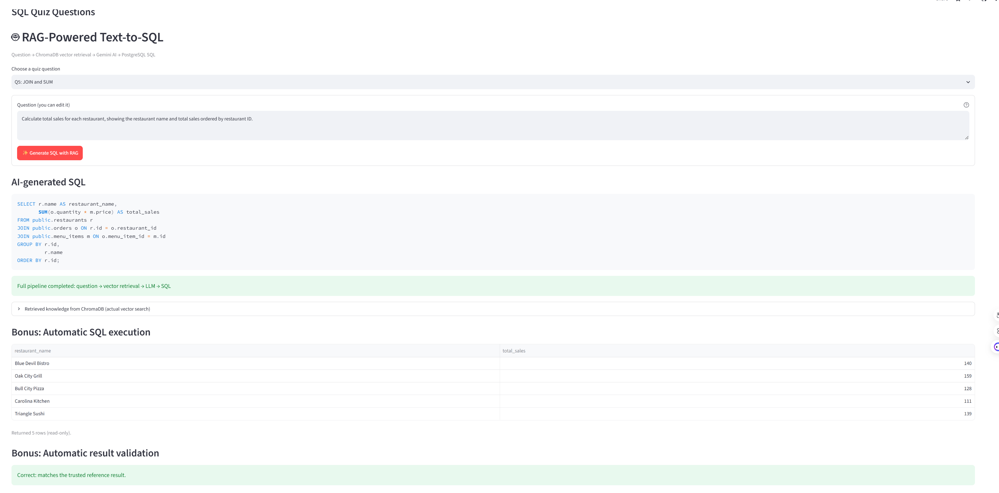
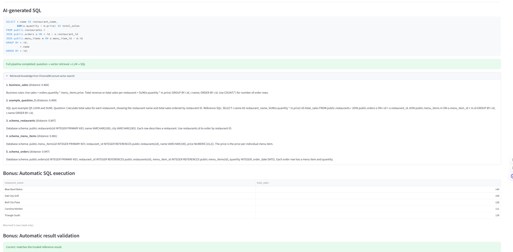
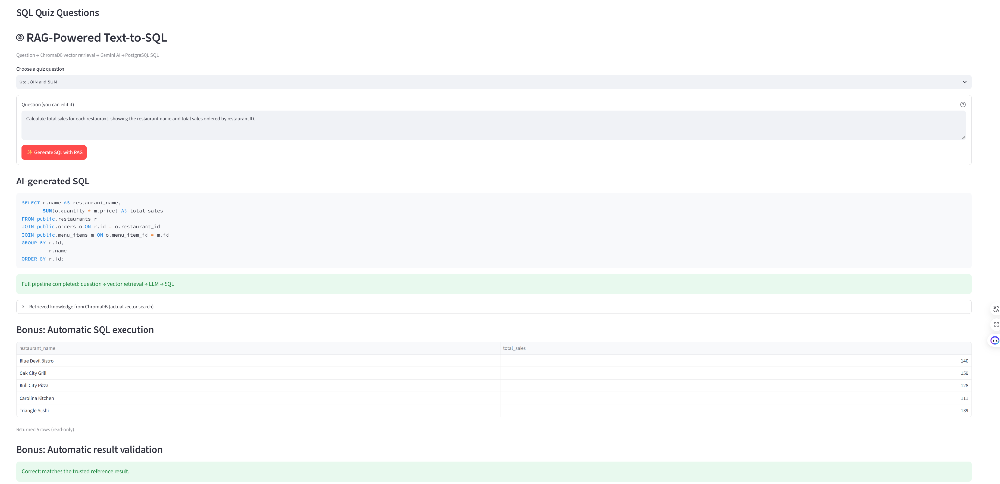

# Restaurant SQL Quiz — RAG-Powered Text-to-SQL

A deployed SQL learning application built with **Python, Streamlit, Supabase PostgreSQL, ChromaDB, and Google Gemini**. This project extends the original Restaurant Sales SQL Quiz with Retrieval-Augmented Generation (RAG): users can ask questions in natural language, retrieve relevant database knowledge, and receive AI-generated PostgreSQL queries. The application also supports automatic, read-only SQL execution and result validation.

**Live application:** [Restaurant SQL Quiz on Streamlit Cloud](https://restaurant-sql-quiz-8agvlli4ykngs9sc2piica.streamlit.app/)

**GitHub repository:** [uswanyouxi/restaurant-sql-quiz](https://github.com/uswanyouxi/restaurant-sql-quiz)

## Features

### Original SQL Quiz

- Five SQL questions covering `SELECT`, `WHERE`, `ORDER BY`, `COUNT`, `GROUP BY`, `JOIN`, and `SUM`.
- User registration and sign-in through Supabase Authentication.
- A SQL editor that executes approved queries against hosted PostgreSQL data.
- Live result tables and the ability to save submitted SQL answers.
- Row-Level Security (RLS), SQL validation, and restricted database permissions.

### RAG-Powered Text-to-SQL

- Choose an existing quiz question or edit it into a custom natural-language question.
- Retrieve relevant schema descriptions, business rules, and SQL examples using **actual ChromaDB vector similarity search**.
- Send the retrieved context and question to the **Google Gemini API** to generate PostgreSQL SQL.
- Display the generated SQL in a readable, formatted code block.
- Expand the *Retrieved knowledge from ChromaDB* section to inspect the retrieved documents and their distances.

### Bonus: Automatic SQL Execution and Validation

- Automatically execute the generated SQL with the existing **restricted, read-only PostgreSQL runner**.
- Display the query results in a table.
- For an unchanged quiz question, execute a trusted reference SQL query through the same restricted runner and compare the results.
- Show **Correct** or **Incorrect** based on the result comparison. For a custom or edited question without a predefined reference, show **Validation unavailable**.

## RAG Architecture

```text
Natural-language question
          |
          v
ChromaDB vector similarity retrieval
  - Database schema
  - Business semantics and JOIN rules
  - Sample question–SQL pairs
          |
          v
Retrieved knowledge + user question
          |
          v
Google Gemini AI API
          |
          v
AI-generated PostgreSQL SELECT query
          |
          +----> Display generated SQL
          |
          v
Restricted read-only PostgreSQL execution (Bonus)
          |
          v
Result table + reference-result validation (Bonus)
```

**PostgreSQL** holds the actual restaurant data and quiz information. **ChromaDB** holds vectorized knowledge that helps the AI understand the database. The Gemini model receives the retrieved context and generates SQL; ChromaDB is not a replacement for PostgreSQL.

### Vector Database and Retrieval

The collection in `rag/vector_store.py` uses a ChromaDB `PersistentClient` and stores **10 knowledge documents** defined in `rag/knowledge.py`:

- **3 schema documents:** `restaurants`, `menu_items`, and `orders`.
- **2 business-rule documents:** JOIN relationships and restaurant sales calculations.
- **5 few-shot SQL examples:** one for each quiz question.

ChromaDB creates embeddings for the knowledge documents and retrieves relevant documents with `collection.query(query_texts=[...])`. The app requests up to **five** retrieved documents per question. This is a real vector search, not a hard-coded schema string inserted into every prompt.

The Chroma index is stored locally in `.chroma/`, which is excluded from Git. On an environment with ephemeral storage, such as a Streamlit Cloud restart, it can be recreated from the committed knowledge source. The first initialization may download Chroma's default embedding model.

### AI API Integration

`rag/generator.py` uses the `google-genai` Python SDK to call **Google Gemini**. The prompt includes the user's natural-language question and the context retrieved from ChromaDB, with instructions to generate a single PostgreSQL `SELECT` query using the available restaurant tables.

The model is configurable through `GEMINI_MODEL` (the code's default is `gemini-3.5-flash-lite`). Model availability and API quotas depend on the Google AI project. No API keys are included in the repository.

### Restaurant Database

The SQL questions use these public business-data tables:

| Table | Main columns | Purpose |
| --- | --- | --- |
| `public.restaurants` | `id`, `name`, `city` | Restaurant details |
| `public.menu_items` | `id`, `restaurant_id`, `name`, `price` | Menu items and prices |
| `public.orders` | `id`, `restaurant_id`, `menu_item_id`, `quantity`, `order_date` | Orders and quantities |

For example, total restaurant sales are calculated from `SUM(orders.quantity * menu_items.price)` after joining the relevant tables.

## How to Use the Deployed Application

1. Open the [live Streamlit website](https://restaurant-sql-quiz-8agvlli4ykngs9sc2piica.streamlit.app/).
2. Sign in with a Supabase Auth account (or register and complete any required email confirmation).
3. In **RAG-Powered Text-to-SQL**, choose a quiz question or enter a custom question.
4. Click **Generate SQL with RAG**.
5. View the **AI-generated SQL** and expand **Retrieved knowledge from ChromaDB (actual vector search)** to see the retrieved context.
6. Review the **Automatic SQL execution** table and **Automatic result validation** status when available.
7. The original SQL Quiz editor remains available below the RAG section for writing, executing, and saving your own SQL answers.

**Grader access:** The deployed application requires sign-in. Please use the application's registration process or obtain approved test-account access through the course's private communication channel. Do **not** publish passwords or test-account credentials in this repository.

## Technology Stack

| Component | Technology |
| --- | --- |
| Language | Python 3.11 |
| Web application | Streamlit |
| Relational database | Supabase PostgreSQL, `psycopg` |
| User authentication | Supabase Auth |
| Vector database | ChromaDB |
| Language model API | Google Gemini (`google-genai`) |
| Query results | pandas |
| SQL validation / display | `pglast`, `sqlparse` |
| Testing and CI | pytest, GitHub Actions |
| Hosting | Streamlit Community Cloud |

## Project Structure

```text
restaurant-sql-quiz/
├── app.py                       # Streamlit entry point and original quiz
├── auth.py                      # Supabase authentication
├── database.py                  # Database configuration
├── quiz.py                      # Load quiz questions from PostgreSQL
├── sql_runner.py                # Restricted read-only SQL execution
├── sql_security.py              # PostgreSQL SQL validation
├── submissions.py               # Save submitted answers
├── rag/
│   ├── knowledge.py             # Schema, business rules, SQL examples
│   ├── vector_store.py          # ChromaDB storage and retrieval
│   ├── generator.py             # Gemini SQL generation and formatting
│   ├── validation.py            # Bonus result comparison
│   └── ui.py                    # Streamlit RAG interface
├── sql/                          # Database schema, seed data, roles/RLS
├── scripts/
│   ├── check_rag_index.py        # Real vector retrieval smoke test
│   ├── check_reference_queries.py # Execute five trusted reference SQL queries
│   └── test_sql_permissions.py   # Restricted database privilege check
├── tests/                        # SQL security and RAG unit tests
├── screenshots/
│   ├── rag_basic.png
│   ├── rag_retrieval.png
│   └── rag_bonus.png
├── .github/workflows/ci.yml
├── .env.example                  # Variable-name examples only
├── .gitignore
├── requirements.txt
└── README.md
```

## Local Setup and Running Instructions

### 1. Clone and open the repository

```powershell
git clone https://github.com/uswanyouxi/restaurant-sql-quiz.git
cd restaurant-sql-quiz
```

### 2. Create and activate a Python 3.11 virtual environment

```powershell
py -3.11 -m venv .venv
.\.venv\Scripts\Activate.ps1
```

### 3. Install the dependencies

```powershell
python -m pip install -r requirements.txt
```

### 4. Configure PostgreSQL, Supabase, and Gemini

This application uses an existing hosted Supabase PostgreSQL database. The `sql/` directory contains the database setup scripts for **initial provisioning only**. Do not rerun seed scripts against an already populated production database.

Copy `.env.example` to `.env` and fill in your **own** credentials:

```dotenv
SUPABASE_URL=https://YOUR_PROJECT.supabase.co
SUPABASE_KEY=YOUR_SUPABASE_PUBLISHABLE_KEY

DB_HOST=YOUR_POOLER_HOST
DB_PORT=5432
DB_NAME=postgres
DB_USER=YOUR_DATABASE_USER
DB_PASSWORD=YOUR_DATABASE_PASSWORD

QUIZ_DB_USER=YOUR_READ_ONLY_DATABASE_USER
QUIZ_DB_PASSWORD=YOUR_READ_ONLY_DATABASE_PASSWORD

GEMINI_API_KEY=YOUR_PRIVATE_GEMINI_KEY
GEMINI_MODEL=gemini-3.5-flash-lite
```

Create a Gemini API key using [Google AI Studio](https://aistudio.google.com/app/apikey). Set `GEMINI_MODEL` to a model available to your API project. Never commit `.env`, database passwords, tokens, or API keys.

### 5. Run the application

```powershell
python -m streamlit run app.py
```

Open the local Streamlit URL (normally `http://localhost:8501`) and sign in.

## Testing and Verification

Run the automated tests:

```powershell
python -m pytest tests/ -v
```

Verify actual vector storage and retrieval:

```powershell
python -m scripts.check_rag_index
```

Check that all five trusted reference SQL queries execute through the restricted database runner:

```powershell
python scripts/check_reference_queries.py
```

Check database permissions:

```powershell
python scripts/test_sql_permissions.py
```

The local and GitHub CI runs have passed **38 automated tests**. The separate ChromaDB smoke test retrieved relevant knowledge from the ten-document collection, and the five trusted reference SQL queries executed successfully. These reference checks do not replace testing the Gemini-generated SQL in the live application.

GitHub Actions (`.github/workflows/ci.yml`) runs Python tests, syntax checks, and the Supabase database permission check on changes to `main` and pull requests targeting `main`. Secret values are configured through GitHub Actions Secrets, not stored in the repository.

## Security and Limitations

- SQL generated by an LLM is **untrusted**; it is checked before execution by `sql_security.py`.
- Execution uses a restricted `quiz_runner` PostgreSQL role and read-only transactions with a statement timeout and result-row limit.
- Only approved restaurant business tables and allowed SQL features are accessible through the quiz execution path.
- Supabase Auth and Row-Level Security protect user submissions.
- Bonus validation executes trusted reference SQL through the **same restricted runner** without reading protected `expected_result` fields or granting elevated permissions.
- Validation compares the expected column names and the multiset of returned values; it does not grade SQL text or enforce result-row ordering.
- Custom questions do not have predefined expected results, so their validation status may be unavailable.
- AI output can be incorrect even if the application pipeline completes. SQL validation and database permissions provide defense in depth, not a universal security guarantee.
- Supabase free projects can become paused after inactivity; the database must be active when the application is evaluated.

## Streamlit Cloud Deployment

The application is deployed from the GitHub **`main`** branch to Streamlit Community Cloud:

**[Open the deployed RAG-powered SQL Quiz](https://restaurant-sql-quiz-8agvlli4ykngs9sc2piica.streamlit.app/)**

The Streamlit application's **Settings → Secrets** must include the existing Supabase settings, `GEMINI_API_KEY`, and `GEMINI_MODEL = "gemini-3.5-flash-lite"` (TOML syntax). The local `.env` is not automatically deployed to Streamlit Cloud. Do not include real credentials in source control. After deployment, confirm that sign-in, vector retrieval, SQL generation, automatic execution and validation work from a separate browser session.

## Final RAG Demonstration Screenshots

### 1. Natural-Language Question to AI-Generated SQL

The application uses **Retrieval-Augmented Generation (RAG)** to generate PostgreSQL queries from natural-language questions. The screenshot shows a selected restaurant sales question and the SQL produced by Gemini using retrieved database knowledge.



### 2. ChromaDB Vector Retrieval

The application performs **actual vector similarity search** to retrieve relevant database schemas, business rules, and SQL examples. The screenshot shows the knowledge returned by ChromaDB, including document IDs, similarity distances, and retrieved text used to provide context for SQL generation.



### 3. Bonus: Automatic SQL Execution and Result Validation

The application automatically executes generated SQL using **read-only PostgreSQL access**, displays the result table, and compares the output against a trusted reference query. The screenshot shows the generated SQL, restaurant sales results, and a successful **Correct** validation outcome.



## Assignment Submission

Submit the **GitHub repository URL**:

**https://github.com/uswanyouxi/restaurant-sql-quiz**

The README includes the working deployment URL, RAG architecture and AI API explanation, setup and run instructions, and the basic and extra-credit screenshots. Screenshots are stored in `screenshots/` and displayed directly through relative Markdown image links above.